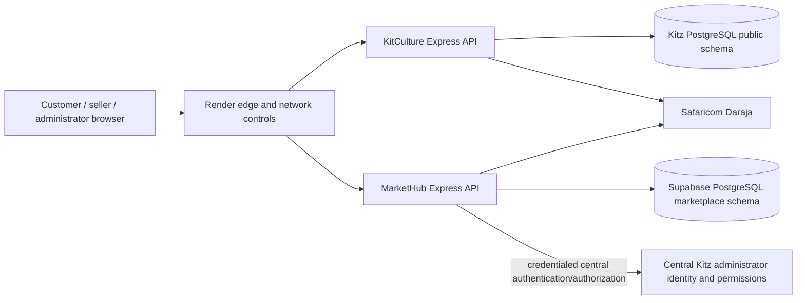

# Security Architecture

## Current application boundaries



Kitz and MarketHub retain separate API deployments, persistence, customer/seller identities, and application schemas. MarketHub administrator identity and permission checks continue to delegate to Kitz; no second local administrator authority was introduced.

## Payment reservation flow

```mermaid
sequenceDiagram
  participant C as Client
  participant API as MarketHub API
  participant DB as Marketplace PostgreSQL
  participant D as Daraja

  C->>API: Initiate publication/contact payment
  API->>DB: Begin transaction; lock listing row FOR UPDATE
  API->>DB: Revalidate listing and query unresolved payment
  alt unresolved payment exists
    DB-->>API: Existing payment
    API-->>C: Return existing state or conflict
  else no unresolved payment
    API->>DB: Insert initiated reservation
    DB-->>API: Commit reservation
    API->>D: Submit STK request after commit
    D-->>API: Provider request identifiers/outcome
    API->>DB: Conditional state transition from initiated
    API-->>C: Pending or ambiguous response
  end
```

The reservation is serialized by the Marketplace listing row. Active states are `initiated`, `pending`, `processing`, and `ambiguous`. Definite terminal provider rejections may be retried under a new reservation; uncertain outcomes remain blocked pending callback or administrator reconciliation. Existing callback verification remains responsible for confirming provider IDs, amount, payer, receipt, and transaction time before settlement.

Kitz guest and authenticated payment routes already lock the order row, check existing payment state, and create the payment row in the same transaction. Unknown outcomes become `requires_review` and are not treated as safe retries.

**Verification boundary:** code and unit/integration suites pass, but no isolated PostgreSQL instance was available for simultaneous HTTP requests. Do not claim a live database concurrency verification.

## Health and diagnostics

- Public `/health` and `/health/live` routes return service liveness only.
- Public readiness routes return only `ready` or `not_ready`; dependency names and provider configuration are not disclosed.
- MarketHub detailed worker/provider data is available only through the administrator diagnostics API protected by central Kitz authorization and `admins:manage` permission.
- Kitz operational APIs continue to use their existing Operations session and role authorization.

## Rate limiting

All existing named Kitz and MarketHub limiters now use `rate-limit-redis` with node-redis when `REDIS_URL` is configured. Each application and policy has a distinct Redis key prefix. Account-targeted login/recovery/payment/submission policies use SHA-256 hashed account identifiers, while application-wide and endpoint policies retain IP-based budgets with SHA-256 hashed, IPv6-normalized keys. IP selection continues to use Express `request.ip` with the existing Render proxy trust settings; raw forwarding headers are not consumed directly by key generators.

Production server processes require `REDIS_URL` and connect before binding/listening; initial connection attempts have an eight-second bound. Redis operations disable offline queuing, use a command timeout, and fail closed with HTTP 503 if a counter cannot be checked. There is no production memory-store fallback. Development/test environments with `REDIS_URL` unset deliberately use express-rate-limit's in-memory store. Dependencies are `redis@6.3.1` and `rate-limit-redis@6.0.2`. A Redis service and production `REDIS_URL` are not configured in this workspace. The shared-store outage, account-bucket, and untrusted-forwarded-header tests pass; real two-instance counter-sharing/expiry verification remains gated on `REDIS_TEST_URL` and is skipped here. Existing Kitz proxy trust (3 hops) and MarketHub proxy trust (1 hop) were preserved, but not verified against the live Render edge topology.

## Database roles and migration boundary

- Kitz now uses a separate `adminPool` when explicit administrator and store URLs differ. Matching URLs intentionally preserve backward compatibility. Production role separation and grants remain unverified.
- MarketHub's runtime URL is validated against the configured PostgreSQL host, database, user, schema, and verified TLS. Its read-only migration preflight checks role attributes, schema access, table DML grants, public-schema isolation, RLS/policy drift, and now Marketplace sequence usage/ownership.
- MarketHub migration execution remains allowlisted and blocked without an approved manifest entry. No schema migration was added or executed.
- Kitz lacks equivalent automated runtime/admin/migration role privilege verification. Do not infer least privilege from separate connection pools.

## Administrator MFA boundary

Administrator authentication is centralized in Kitz and MarketHub calls Kitz for authentication and authorization. MFA must therefore be implemented as a central Kitz challenge/enrollment flow and then propagated through this service contract. It requires reviewed additive storage, an encryption key-management plan, recovery-code handling, revocation behavior, and cross-app tests. No MFA schema or endpoint was added, avoiding a partial second-factor bypass or unreviewed migration.
The detailed implementation design is in [SECURITY_MFA_DESIGN.md](SECURITY_MFA_DESIGN.md); it is not evidence that MFA is implemented.

## Phase 5 security engines (2026-11-16)

- The Kitz Express API now has a code-defined request inspector, defaulting to `WAF_MODE=detect`. Optional `block` mode only rejects high-confidence API patterns. It is not a network/CDN WAF; external edge protection remains unknown.
- WAF findings enter the existing security telemetry queue and repeated WAF detections can form persisted monitoring alerts when the Operations schema/worker are operational. The Operations WAF page is read-only and reports policy persistence as false.
- Operations exposes an authenticated CycloneDX 1.5 SBOM generated from local Kitz and MarketHub npm lockfiles and a local-only, bounded secret scan whose results contain no secret values or secret-derived fingerprints.
- MarketHub payment monitoring uses a dedicated read-only service endpoint and its own `marketplace` schema. Kitz Operations calls it only server-side using the fixed same-origin feed URL and shared service token. Payment status mutation is not exposed.
- Identity bridge remains default-disabled. Migrations, database baselines, Redis multi-instance behavior, MarketHub feed configuration, staging, and production have not been verified. See `SECURITY_IMPLEMENTATION_REPORT.md` and `PHASE_5_COMPLETION_REPORT.md`.
