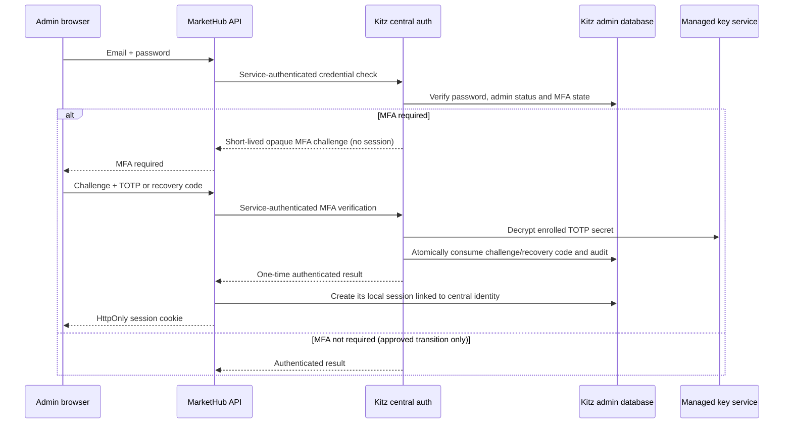

# Central Administrator MFA Design

## Status

Design only. MFA is not implemented. No database migration or login-contract change is proposed as approved or production-ready by this document.

## Authority and boundary

Kitz is the source of administrator identity, status, role, permissions, and authentication. MarketHub must continue to delegate administrator authentication and authorization to Kitz. MarketHub must not independently accept a password-only login or issue a session before Kitz confirms the MFA requirement was satisfied.

## Enrollment

1. Require an active privileged Kitz administrator, recent password authentication, and step-up confirmation if MFA is already enabled.
2. Create a pending enrollment with a random TOTP secret and a short expiry. Do not mark the account MFA-enabled yet.
3. Encrypt the secret using envelope encryption backed by a managed KMS/HSM. Store ciphertext, key version/reference, nonce, authentication tag, and lifecycle timestamps. Never store plaintext secrets or place a long-lived encryption key in ordinary application environment variables.
4. Display the enrollment QR/secret once over TLS with `Cache-Control: no-store`; never log it or include it in telemetry.
5. Require a valid current TOTP code before promoting the enrollment to active in a transaction.
6. Generate high-entropy one-time recovery codes; show them once and persist only salted/pepper-protected hashes. Do not email recovery codes.
7. Write a security audit event for enrollment, completion, cancellation, recovery-code regeneration, and MFA reset.

## TOTP verification

- Use a maintained RFC 6238 implementation and RFC 4226 HOTP semantics, with a six/eight-digit code, 30-second step, and a narrow clock-skew window.
- Verify in constant time where the library permits and track the last accepted time-step to reject code replay.
- Rate-limit by administrator account and source IP through the shared limiter. Add a short-lived central challenge record, one-time consumption, expiration, and attempt counter in the same transaction as the resulting Kitz session issuance.
- The challenge must bind to the administrator, intended portal/application, and purpose; it is not itself a bearer session.

## Recovery and reset

- Consume recovery codes atomically once; hash them at rest and record which code index was consumed without recording the code.
- Recovery should revoke all Kitz administrator sessions and MarketHub local sessions linked to the central Kitz administrator. MarketHub must reject cached/local sessions if central authorization is unavailable or the account/session is revoked.
- MFA reset requires a separately approved, audited recovery workflow with identity verification and a cooling-off period. For Super Admin/Finance Admin, require two-person approval or an equivalent controlled owner procedure. Do not add a password-only reset bypass.
- Notify the administrator through existing Brevo delivery and create a security event; notification delivery must not reveal recovery secrets.

## Step-up authentication

Sensitive operations (role/permission changes, administrator suspension, payment reconciliation/refund, firewall policy changes, MFA reset) require a recent central MFA assertion. Use a short-lived, one-use assertion bound to actor, action class, target, and request nonce. Kitz must validate it server-side; MarketHub must not treat a frontend flag or local role as step-up proof.

## Session revocation and central contract

- Kitz remains authoritative for central admin session revocation and permission changes.
- The service-to-service authentication contract should return either `mfa_required` plus an opaque challenge, or an authenticated identity with a signed/one-use central assurance claim. No password-only authenticated result may be returned when policy requires MFA.
- MarketHub must relay the challenge without persisting the password, then complete MFA through Kitz service-authenticated endpoints before inserting a MarketHub session.
- Permission and account-state checks remain live against Kitz on protected MarketHub routes, preserving current central authorization behavior.

## Additive migration plan

A separately reviewed additive Kitz migration would likely add:

- `admin_mfa_credentials`: administrator FK, encrypted secret fields, key version, status (`pending`/`active`/`disabled`), last accepted TOTP timestep, timestamps.
- `admin_mfa_recovery_codes`: administrator FK, unique code hash, consumed timestamp, created timestamp.
- `admin_mfa_challenges`: administrator FK, opaque challenge hash, purpose/application, expiry, attempt count, consumed timestamp.
- Optional step-up assertion records if stateless signed assertions are not selected.

Add supporting uniqueness and expiry indexes, restrictive foreign keys, least-privilege DML grants, audit events, and retention. Migration must not rewrite or merge the MarketHub schema. Do not apply a migration until the Kitz migration owner approves the exact SQL and rollback/recovery plan.

## Blockers before implementation

- Select and provision a managed KMS/HSM service and workload identity for both Kitz deployment regions/environments; define key rotation and decrypt access controls.
- Approve the additive Kitz migration and runtime/admin grants.
- Version and test the Kitz-to-MarketHub service contract, including challenge flow and session revocation.
- Add isolated PostgreSQL integration tests for concurrent challenge consumption, code replay, recovery-code reuse, cross-application login, and revoked-session rejection.
- Add MFA UI enrollment/verification/recovery only after backend and service-contract tests pass.
